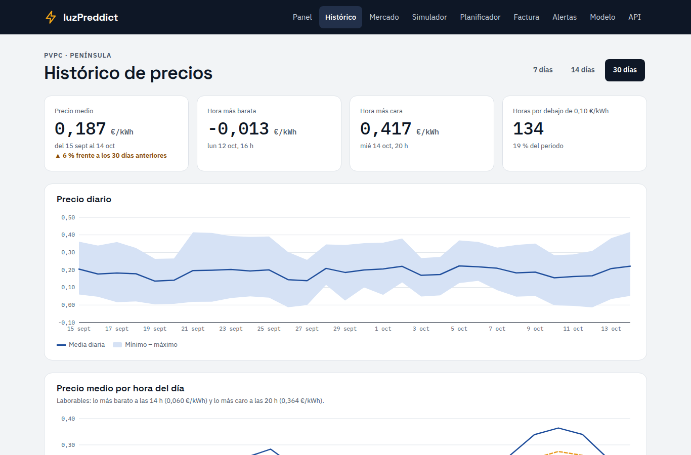
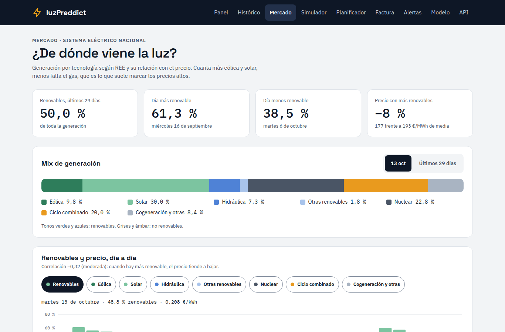
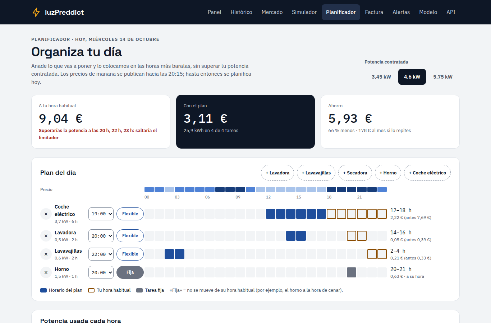
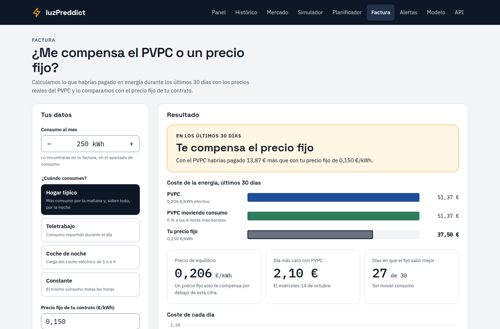
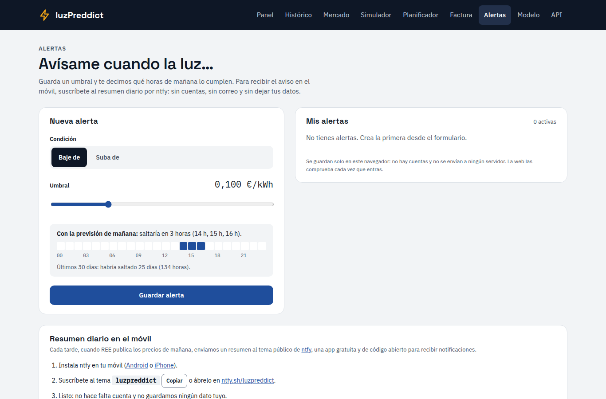
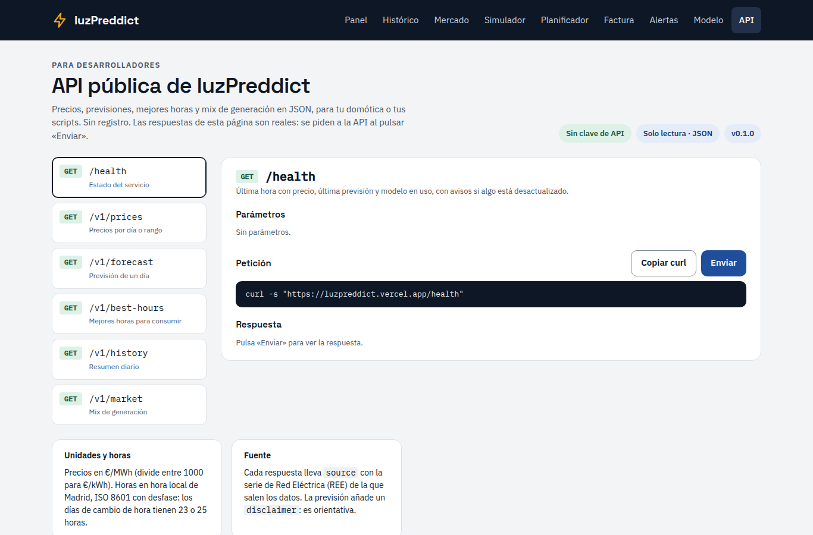
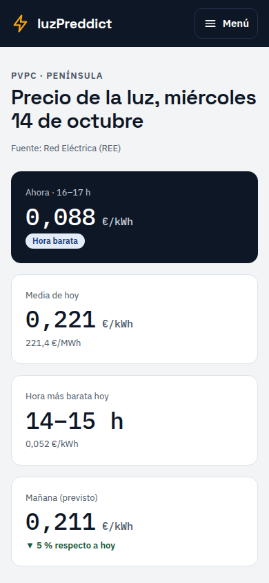
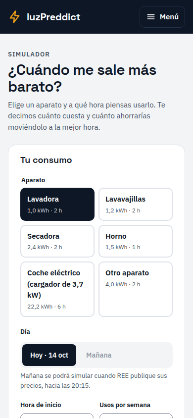

<a id="top"></a>
# luzPreddict

**Español** | [English](./README.en.md)

### Previsión del precio de la luz (PVPC) del día siguiente, hora a hora, con herramientas para decidir cuándo consumir

[](https://github.com/pdawgabriel-hub/luzPreddict/actions/workflows/ci.yml)


**[Abrir la web](https://luzpreddict.vercel.app)** · **[Documentación de la API](https://luzpreddict.vercel.app/docs)** · **[Guía técnica](https://pdawgabriel-hub.github.io/luzPreddict/)**


---

## Índice

- [Descripción general](#descripcion-general)
- [Qué problema resuelve](#problema)
- [Arquitectura](#arquitectura)
- [La web](#la-web)
- [Capturas de pantalla](#capturas)
- [Enlaces disponibles](#enlaces)
- [El modelo y sus resultados](#modelo)
- [Calidad y tests](#calidad)
- [Puesta en marcha](#puesta-en-marcha)
- [Documentación técnica](#documentacion-tecnica)
- [Limitaciones y mejoras posibles](#limitaciones)
- [Fuente de los datos](#datos)
- [Licencia](#licencia)
- [Autor](#autor)

---

<a id="descripcion-general"></a>
## Descripción general

**luzPreddict** prevé el **PVPC** (el precio regulado de la luz en España) del día siguiente,
hora a hora, con un modelo de machine learning, y lo publica en una **web** y en una **API
pública** junto con herramientas para decidir cuándo consumir.

Cada tarde, cuando Red Eléctrica (REE) publica los precios, una tarea automática descarga los
datos, actualiza la previsión y mide cuánto acertó la del día anterior. La web y la API solo leen esos resultados, así que responden al instante y el sistema
completo **cuesta 0 € al mes**.

En resumen:

- **Datos reales** de REE desde junio de 2021: PVPC horario y mix de generación.
- **Modelo LightGBM** que se equivoca un **30 % menos** que la mejor referencia simple, con
  un **rango probable** para cada hora y evaluación diaria frente al precio real.
- **Web con nueve secciones:** panel, histórico, mercado, simulador, planificador, factura,
  alertas, evaluación del modelo y documentación de la API.
- **API pública** sin clave, documentada con OpenAPI, para domótica y scripts.
- **Automatización completa** con GitHub Actions: tarea diaria, reentrenamiento semanal,
  migraciones, CI, auditoría Lighthouse y Dependabot.

El proyecto es una pieza de **portfolio técnico** que recorre todo el ciclo de un producto de
datos: ingesta, modelo, base de datos, API, web, automatización, despliegue y documentación.

[Volver arriba](#top)

---

<a id="problema"></a>
## Qué problema resuelve

El PVPC cambia **cada hora** y la diferencia dentro de un mismo día es grande. El 14 de octubre
de 2026, la hora más barata costó **0,052 €/kWh** y la más cara, **0,417 €/kWh**: ocho veces
más. Poner la lavadora a las 20:00 costaba **0,39 €**; a las 14:00, **0,05 €**.

REE publica los precios del día siguiente hacia las 20:15. Hasta entonces, nadie sabe cuánto
costará mañana cada hora, y después solo se conoce un día. **luzPreddict adelanta esa
información**: por la mañana ya da una previsión de mañana, y por la tarde, la de pasado mañana.

### Para quién

| Usuario | Qué gana |
|---|---|
| **Hogares con PVPC** | Saber a qué hora poner la lavadora, el lavavajillas o el horno, y cuánto ahorran al año moviéndolos. El Simulador lo calcula: unos 71 € al año solo con la lavadora, a cuatro lavados por semana. |
| **Coche eléctrico y autoconsumo** | Programar la carga en las horas más baratas sin superar la potencia contratada (Planificador). |
| **Domótica y desarrolladores** | Una API sin clave para que Home Assistant o un script enciendan aparatos en las mejores horas. |
| **Quien duda de su tarifa** | Comprobar con sus datos si le compensa el PVPC o un precio fijo (Factura). |
| **La red eléctrica** | Las horas baratas suelen coincidir con más eólica y solar (página Mercado): desplazar consumo hacia ellas aprovecha mejor las renovables. |

### Modelos de negocio posibles

El proyecto está desplegado como servicio gratuito, pero la misma base permite varios modelos:

- **API de pago por volumen** para integradores de domótica, gestores energéticos y
  aplicaciones de terceros. La gratuita conserva su límite de 60 peticiones por minuto.
- **Marca blanca o widget** para comercializadoras y comparadores de tarifas, que pueden ofrecer
  la previsión y el simulador a sus clientes.
- **Avisos en el móvil**, como un resumen diario de los precios de mañana, umbrales personales
  o el aviso "carga el coche ahora". La tarea diaria ya genera ese resumen y lo envía por ntfy,
  de momento solo al desarrollador.
- **Servicio para pymes** con consumo desplazable (lavanderías, obradores, cámaras frigoríficas,
  flotas eléctricas) que planifiquen su producción según el precio previsto.

[Volver arriba](#top)

---

<a id="arquitectura"></a>
## Arquitectura

El esquema del principio resume el sistema. Separa **lo pesado** (calcular) de **lo que se sirve** (web y API):

1. **REE**, la fuente. La API pública de Red Eléctrica da el PVPC horario y el mix de
   generación, sin clave.
2. **GitHub Actions**, el cálculo. Cada tarde, la **tarea diaria** descarga lo nuevo, prevé el
   siguiente día con el modelo guardado y mide el error de los anteriores. Se repite dos horas
   después por si REE se retrasa. Cada domingo se **reentrena** el modelo. Las migraciones de la
   base de datos se aplican solas al llegar a `main`.
3. **Neon (PostgreSQL)**, los datos. Guarda precios, generación, previsiones con su intervalo,
   errores diarios y el propio modelo entrenado. **Upstash (Redis)** cuenta las peticiones para
   el límite de la API.
4. **Vercel**, el servicio. Sirve la **web** (React) y la **API** (FastAPI) desde el mismo dominio
   y desde su CDN, que guarda cada respuesta hasta la siguiente actualización: la mayoría de las
   visitas no llegan ni a la API ni a la base de datos.
5. **ntfy**, los avisos internos. Envían al móvil del desarrollador, por un tema privado, el
   resumen de los precios de mañana (señal de que la tarea ha funcionado) y un aviso si falla
   algún workflow. No es un servicio para los usuarios: nadie más se puede suscribir.

**Por qué así:** la API no carga pandas ni el modelo (solo lee filas), lo que la hace rápida y
gratuita en Vercel; el cálculo dura minutos al día, que GitHub Actions da sin coste; y todo está
en **Frankfurt**, así que cada consulta se queda en Europa. Los detalles y las decisiones, en la
[guía técnica](https://pdawgabriel-hub.github.io/luzPreddict/arquitectura/).

[Volver arriba](#top)

---

<a id="la-web"></a>
## La web

| Sección | Para qué sirve |
|---|---|
| **Panel** | Precio de ahora, media y hora más barata de hoy, previsión de mañana con su rango probable, las próximas horas y las mejores horas para consumir |
| **Histórico** | Evolución de 7, 14 o 30 días, precio medio por hora, laborables frente a fines de semana y mapa de calor |
| **Mercado** | Mix de generación y cómo influye cada tecnología en el precio |
| **Simulador** | Cuánto cuesta poner un aparato a una hora y cuánto se ahorra moviéndolo |
| **Planificador** | Reparto de varios aparatos en las horas baratas sin superar la potencia contratada |
| **Factura** | Si te compensa el PVPC o un precio fijo, con tu consumo y los precios reales de 30 días |
| **Alertas** | Umbral personal guardado en el navegador: qué horas de mañana lo cumplen y cuántas veces habría saltado |
| **Modelo** | Cuánto acierta la previsión: error por hora y por día, y frente a las referencias |
| **API** | Documentación de la API pública con peticiones reales y comandos `curl` |

La web no necesita guía de uso: cada sección explica lo que muestra. Es accesible (gráficas con
tablas de datos para lectores de pantalla y navegación con teclado) y funciona en el móvil.

[Volver arriba](#top)

---

<a id="capturas"></a>
## Capturas de pantalla

| Panel |
|---|
|  |

| Histórico | Mercado |
|---|---|
|  |  |

| Simulador | Planificador |
|---|---|
|  |  |

| Factura | Alertas |
|---|---|
|  |  |

| Modelo | API |
|---|---|
|  |  |

| Panel en el móvil | Simulador en el móvil |
|---|---|
|  |  |

*Capturas de la web publicada, 14 de octubre de 2026.*

[Volver arriba](#top)

---

<a id="enlaces"></a>
## Enlaces disponibles

### Web

| Enlace | Qué se ve |
|---|---|
| [luzpreddict.vercel.app](https://luzpreddict.vercel.app) | Panel: precio de ahora, de hoy y previsión de mañana |
| [/historico](https://luzpreddict.vercel.app/historico) | Histórico de precios |
| [/mercado](https://luzpreddict.vercel.app/mercado) | Mix de generación y su relación con el precio |
| [/simulador](https://luzpreddict.vercel.app/simulador) | Simulador de coste y ahorro por aparato |
| [/planificador](https://luzpreddict.vercel.app/planificador) | Planificador del día |
| [/factura](https://luzpreddict.vercel.app/factura) | PVPC frente a precio fijo |
| [/alertas](https://luzpreddict.vercel.app/alertas) | Alertas por umbral, guardadas en el navegador |
| [/modelo](https://luzpreddict.vercel.app/modelo) | Evaluación del modelo |
| [/desarrolladores](https://luzpreddict.vercel.app/desarrolladores) | Documentación de la API dentro de la web |

### API pública (JSON, sin clave)

| Enlace | Para qué |
|---|---|
| [/docs](https://luzpreddict.vercel.app/docs) | Documentación interactiva (Swagger): probar cada endpoint desde el navegador |
| [/openapi.json](https://luzpreddict.vercel.app/openapi.json) | Esquema OpenAPI, para generar clientes |
| [/health](https://luzpreddict.vercel.app/health) | Estado del servicio: último precio, última previsión y modelo en uso |
| [/v1/prices](https://luzpreddict.vercel.app/v1/prices) | PVPC de hoy (o de un día o rango con `date`, `start` y `end`) |
| [/v1/forecast](https://luzpreddict.vercel.app/v1/forecast) | Última previsión, con el rango probable de cada hora |
| [/v1/best-hours?hours=3](https://luzpreddict.vercel.app/v1/best-hours?hours=3) | Las 3 horas seguidas más baratas de hoy |
| [/v1/history](https://luzpreddict.vercel.app/v1/history) | Resumen de los últimos 30 días |
| [/v1/market](https://luzpreddict.vercel.app/v1/market) | Mix de generación de los últimos 30 días |

### Proyecto

| Enlace | Para qué |
|---|---|
| [Guía técnica](https://pdawgabriel-hub.github.io/luzPreddict/) | Cómo está construido todo, por capítulos |
| [GitHub Actions](https://github.com/pdawgabriel-hub/luzPreddict/actions) | Ejecuciones de la tarea diaria, el reentrenamiento, el CI y Lighthouse |

[Volver arriba](#top)

---

<a id="modelo"></a>
## El modelo y sus resultados

Un modelo **LightGBM** con 17 variables: calendario (hora, día de la semana, festivos, periodo
de la tarifa 2.0TD) y precios de días anteriores (la misma hora hace 1, 2, 3 y 7 días, y medias,
mínimos y máximos recientes). Nunca usa el día que predice: los tests lo comprueban alterando los
precios futuros.

Se evalúa como en producción (*walk-forward*): cada día se predice solo con los anteriores.
Los parámetros se eligieron en 2024 y se midieron después en un periodo distinto:

| Error absoluto medio (€/MWh) | LightGBM | Precio de ayer | Media 7 días |
|---|---|---|---|
| Validación (2024) | **15,6** | 26,5 | — |
| Prueba (desde 2025) | **≈ 16** | ≈ 28,5 | ≈ 28,9 |
| Últimos 90 días, al entrenar el 13/10/2026 | **22,9** | 33,8 | 32,9 |

Además de la previsión, el modelo da un **rango probable** para cada hora, con dos modelos de
regresión por cuantiles: en el periodo de prueba, el precio real cayó dentro el **79,5 %** de las
horas. Si el modelo no se puede usar, la web publica "precio de ayer" y lo indica. El detalle está
en la [guía técnica](https://pdawgabriel-hub.github.io/luzPreddict/modelo/).

[Volver arriba](#top)

---

<a id="calidad"></a>
## Calidad y tests

- **608 tests de Python** (pytest) contra una base PostgreSQL de pruebas real: ingesta con
  respuestas reales de REE, días de 23 y 25 horas, fugas del futuro en el modelo, escrituras
  idempotentes, migraciones, varios días seguidos de la tarea diaria y cada endpoint de la API.
- **214 tests de la web** (Vitest y Testing Library) con cobertura mínima obligatoria: 98 % de
  sentencias y 87 % de ramas.
- **CI en cada push:** ruff, oxlint, TypeScript, tests, build y tipos de la API al día.
- **Lighthouse tras cada despliegue:** accesibilidad **100** en las páginas auditadas y rendimiento
  entre 83 y 91 en móvil.
- **Dependabot** semanal y **pre-commit** antes de cada commit.

[Volver arriba](#top)

---

<a id="puesta-en-marcha"></a>
## Puesta en marcha

### Con Docker

Sin instalar Python ni Node: solo Docker con Compose.

```bash
make docker-up     # base de datos, API y web
make docker-seed   # la primera vez: histórico de REE, entrenamiento y previsión de mañana
make docker-down   # para todo (los datos se conservan)
```

La web queda en http://localhost:8080, con la API en las mismas rutas que en producción.

### Para desarrollar

Requisitos: Python 3.12, Node 22 y PostgreSQL 16.

```bash
python3 -m venv venv
make install          # dependencias y hooks de pre-commit
cp .env.example .env  # DATABASE_URL y TEST_DATABASE_URL
make migrate backfill train pipeline
make dev              # API en :8000 y web en :5173
```

`make help` lista todos los comandos. La web también arranca sin backend, con datos de ejemplo:
`make web-mocks`.

[Volver arriba](#top)

---

<a id="documentacion-tecnica"></a>
## Documentación técnica

La **[guía técnica](https://pdawgabriel-hub.github.io/luzPreddict/)** explica el proyecto en
detalle, por capítulos:

- **Arquitectura:** las piezas, el ciclo de un día y por qué se eligió cada servicio.
- **Datos:** la API de REE, la ingesta, los cambios de hora, la limpieza y la base de datos.
- **Modelo:** variables, referencias, LightGBM, backtest e intervalos de predicción calibrados.
- **Automatización:** los workflows de GitHub Actions, las notificaciones y los secretos.
- **API:** endpoints, errores uniformes, caché en la CDN y límite de peticiones.
- **Web:** organización del código, gráficas accesibles y datos de ejemplo.
- **Calidad, despliegue y operación:** tests, Lighthouse, Vercel, Neon y qué hacer si algo falla.
- **Desarrollo local y decisiones:** cómo ponerlo en marcha y qué se descartó, y por qué.

Su código fuente está en [`docs/`](docs/) y se publica sola con cada cambio.

[Volver arriba](#top)

---

<a id="limitaciones"></a>
## Limitaciones y mejoras posibles

- **Solo el sistema peninsular.** La API pública de REE solo publica el PVPC peninsular. Canarias,
  Baleares, Ceuta y Melilla necesitarían ESIOS, la otra API de REE, que pide token.
- **Sin previsiones de demanda, eólica y solar como variables**, por el mismo motivo: la API
  pública no las tiene para el día siguiente. Es la mejora con más potencial para el modelo.
- **La previsión es orientativa** y no garantiza el precio final. En épocas muy volátiles, el
  rango probable acierta menos de 8 de cada 10 horas; la página Modelo muestra la cifra real.

[Volver arriba](#top)

---

<a id="datos"></a>
## Fuente de los datos

Los precios del PVPC y el mix de generación proceden de la
[API pública de Red Eléctrica (REE)](https://www.ree.es/es/apidatos) y se rigen por sus propias
condiciones de uso.

[Volver arriba](#top)

---

<a id="licencia"></a>
## Licencia

Este proyecto se publica como **pieza de portfolio personal** y tiene una licencia de uso
restringido. En detalle:

- Puedes **ver, clonar y ejecutar** el código con fines de **aprendizaje, evaluación técnica o
  revisión de portfolio** (por ejemplo, como parte de un proceso de selección o para estudiar la
  arquitectura del proyecto).
- Puedes **modificar el código para uso personal, no comercial**, siempre citando la autoría
  original.
- **No está permitido el uso comercial** del proyecto, ni total ni parcial (incluyendo su
  despliegue como producto o servicio, su reventa o su integración en soluciones comerciales de
  terceros) sin autorización expresa del autor.
- **El único titular con derecho a explotación comercial del proyecto es el autor original**,
  [Gabriel](https://github.com/pdawgabriel-hub).

El texto legal completo se encuentra en [`LICENSE.md`](./LICENSE.md) (versión en inglés:
[`LICENSE.en.md`](./LICENSE.en.md)).

[Volver arriba](#top)

---

<a id="autor"></a>
## Autor

Desarrollado por **Gabriel Iborra Vicente** como proyecto de portfolio, con el objetivo de
demostrar el desarrollo completo de un producto de datos: desde la ingesta y el modelo de machine
learning hasta una API pública, una web accesible, la automatización y el despliegue en la nube
sin coste.

[Volver arriba](#top)
