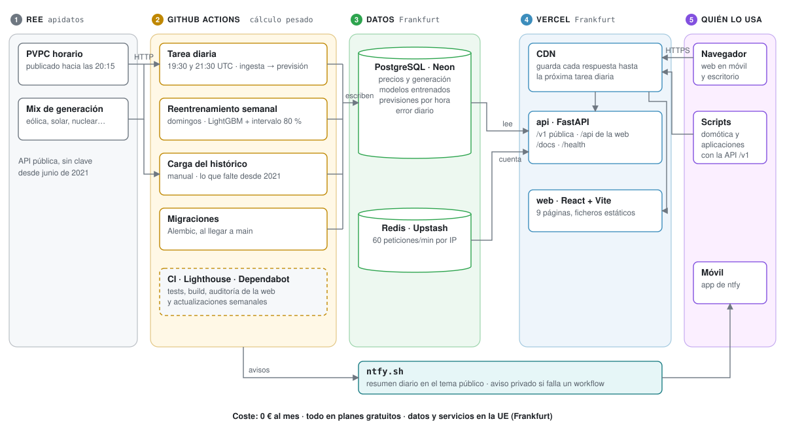

# Arquitectura



## La idea central: separar lo pesado de lo que se sirve

El proyecto tiene dos partes con necesidades muy distintas:

- **Calcular** (descargar datos, entrenar, prever) necesita pandas, scikit-learn y LightGBM,
  tarda minutos y ocurre **unas pocas veces al día**.
- **Servir** (la web y la API) tiene que responder en milisegundos, **en cualquier momento**,
  y solo necesita leer resultados ya calculados.

Por eso el cálculo vive en **GitHub Actions** y el servicio en **Vercel**, y entre los dos
solo hay una **base de datos PostgreSQL**. La API no importa pandas ni el modelo: lee
filas y las devuelve. Esta separación es la que permite desplegarlo todo gratis.

## Las piezas

| Pieza | Qué hace | Dónde está el código |
|---|---|---|
| **REE (apidatos)** | Fuente de los datos: PVPC horario y generación por tecnología. API pública sin clave. | `src/ingestion/` |
| **GitHub Actions** | Ejecuta la tarea diaria, el reentrenamiento semanal, la carga del histórico, las migraciones, el CI y Lighthouse. | `.github/workflows/`, `src/pipeline.py` |
| **PostgreSQL (Neon)** | Guarda precios, generación, modelos entrenados, previsiones y errores diarios. | `src/db/`, `alembic/` |
| **Redis (Upstash)** | Cuenta las peticiones por IP para el límite de la API. | `src/api/rate_limit.py` |
| **Vercel** | Sirve la web estática y la API (función de Python) desde su CDN, en Frankfurt. | `vercel.json`, `src/api/`, `frontend/` |
| **ntfy.sh** | Envía el resumen diario (tema público) y los avisos de fallo (tema privado). | `src/notifications/`, workflows |

## El ciclo de un día

1. **Hacia las 20:15** (hora de Madrid), REE publica el PVPC de mañana.
2. **A las 19:30 UTC** (21:30 en verano, 20:30 en invierno) arranca la **tarea diaria** en
   GitHub Actions:
    - descarga lo que falte de REE y lo guarda en Neon;
    - prevé el primer día sin precio publicado con el modelo guardado y guarda la previsión
      con su intervalo;
    - calcula el error de las previsiones de los últimos días frente al precio real;
    - si los precios de mañana acaban de llegar, envía el resumen a ntfy.
3. **A las 21:30 UTC** se repite como reintento. La tarea es idempotente: si la primera
   salió bien, no cambia nada; si REE aún no había publicado, la completa.
4. La API marca sus respuestas para que la **CDN de Vercel** las guarde hasta la siguiente
   ejecución (19:50 o 21:50 UTC). Mientras tanto, la mayoría de las visitas no llegan ni a la
   API ni a la base de datos.
5. **Cada domingo** se reentrena el modelo con los dos últimos años y se guarda en Neon. La
   tarea del día siguiente ya usa el nuevo.

## Decisiones de diseño

**¿Por qué GitHub Actions y no un servidor?** El cálculo dura unos minutos al día. Un
servidor encendido las 24 horas sería caro o tendría que apagarse; Actions da máquinas
gratis (repositorio público) bajo demanda, con logs, reintentos y avisos de fallo.

**¿Por qué PostgreSQL y no ficheros?** La web necesita consultas por rango de fechas y la
tarea diaria necesita escrituras idempotentes (`INSERT … ON CONFLICT`). Además, el modelo
entrenado se guarda en la propia base de datos, así que no hace falta almacenamiento de
ficheros.

**¿Por qué Neon?** PostgreSQL gestionado con plan gratuito (0,5 GB), región en Frankfurt y
una cadena de conexión *pooled* pensada para funciones serverless, que abren y cierran
conexiones en cada petición. Se apaga sola sin uso; el primer acceso tarda un segundo en
despertarla.

**¿Por qué Vercel?** Sirve la web estática desde su CDN y ejecuta la API de Python como
función, todo desde el mismo dominio. Al compartir dominio, la web llama a la API sin CORS.
Se usa su modelo de **Services**: un servicio para la web y otro para la API, en el mismo
proyecto (ver [Despliegue](despliegue.md)).

**¿Por qué todo en Frankfurt?** Neon, Upstash y la función de Vercel están en la misma
región: cada consulta de la API a la base de datos se queda dentro de Europa y tarda pocos
milisegundos.

**¿Por qué sin cuentas de usuario?** No hace falta: las alertas personales se guardan en el
navegador y el resumen diario va por ntfy, que no pide registro. Así no hay datos personales
que proteger.

## Estructura del repositorio

```text
luzPreddict/
├── src/
│   ├── ingestion/      # descarga de REE (cliente genérico, PVPC, generación, backfill)
│   ├── processing/     # limpieza, variables del modelo y conversión desde la base de datos
│   ├── models/         # referencias, LightGBM, backtest, entrenamiento, registro y previsión
│   ├── db/             # tablas (SQLAlchemy), sesión y repositorio
│   ├── services/       # lógica de negocio sin pandas: mejores horas, simulador, planificador…
│   ├── notifications/  # envío a ntfy
│   ├── api/            # FastAPI: app, dependencias, errores, caché, límite y routers
│   ├── utils/          # configuración, calendario (cambios de hora, festivos, tarifa) y logs
│   └── pipeline.py     # comandos: backfill, train, daily, predict
├── alembic/            # migraciones de la base de datos
├── frontend/           # web: React + TypeScript + Vite
├── tests/              # tests de Python (pytest)
├── docs/               # esta guía (MkDocs) e imágenes del README
├── notebooks/          # análisis exploratorio y comparación de modelos
├── .github/            # workflows, Dependabot y configuración de Lighthouse
├── vercel.json         # despliegue en Vercel (servicios web y api)
├── docker-compose.yml  # base de datos, API y web en local con un comando
└── Makefile            # todos los comandos habituales (make help)
```

## Dependencias de Python en tres niveles

| Fichero | Para qué | Dónde se instala |
|---|---|---|
| `requirements.txt` | Solo la API: FastAPI, SQLAlchemy, psycopg, pydantic-settings | Vercel |
| `requirements-pipeline.txt` | Lo anterior más pandas, scikit-learn, LightGBM y Alembic | GitHub Actions |
| `requirements-dev.txt` | Lo anterior más pytest, ruff, pre-commit, uvicorn y Jupyter | Tu máquina y el CI |

Mantener la API ligera es una regla del proyecto: `src/db` y `src/services` no importan
pandas, y un test (`tests/test_api_app.py`) comprueba que importar la API no carga pandas,
numpy, scikit-learn ni LightGBM.
